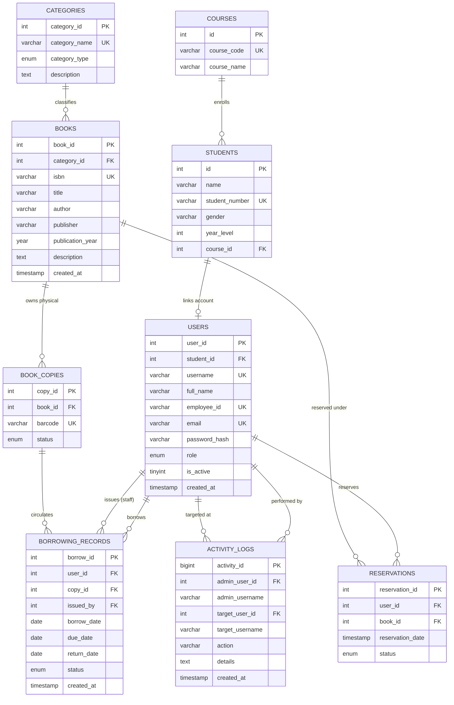
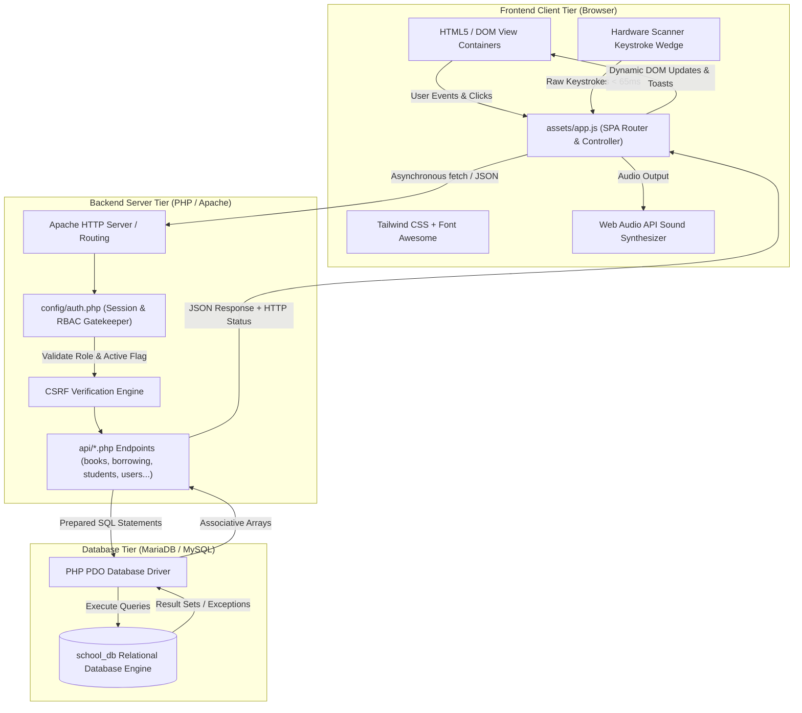

# Comprehensive System Documentation
## Automated School Library Management System (4BIT&1BYTE - LIBRARY_MS)

---

## Document Control & System Overview

- **Document Title:** Automated School Library Management System Technical Documentation
- **Project Name:** Library Management System (`LIBRARY_MS`)
- **System Version:** 2.4.0 (Production Release)
- **Target Database:** MySQL / MariaDB (`school_db`)
- **Operating Environment:** Offline-First On-Premise XAMPP Environment (Apache, PHP 8.x, MariaDB/MySQL)
- **Target Audience:** System Administrators, Technical Evaluators, Project Defense Committees, Software Engineers, and Maintenance Technicians

---

## Table of Contents

1. [Technologies, Tools, and Frameworks Used](#1-technologies-tools-and-frameworks-used)
2. [User Roles and Their Functionalities](#2-user-roles-and-their-functionalities)
3. [Detailed Explanation of How Every Feature Works](#3-detailed-explanation-of-how-every-feature-works)
4. [User Permissions and Access Control (RBAC)](#4-user-permissions-and-access-control-rbac)
5. [Database Structure, Relationships, and Data Dictionary](#5-database-structure-relationships-and-data-dictionary)
6. [System Modules and End-to-End Workflows](#6-system-modules-and-end-to-end-workflows)
7. [Complete System Interaction Workflow](#7-complete-system-interaction-workflow)
8. [Frontend, Backend, and Database Communication Architecture](#8-frontend-backend-and-database-communication-architecture)
9. [Security, Integrity, and Data Protection Mechanisms](#9-security-integrity-and-data-protection-mechanisms)
10. [Project File and Directory Structure](#10-project-file-and-directory-structure)
11. [Feature Implementation Status Matrix](#11-feature-implementation-status-matrix)
12. [System Limitations and Future Recommendations](#12-system-limitations-and-future-recommendations)

---

# 1. Technologies, Tools, and Frameworks Used

The School Library Management System is architected as an **Offline-First, Self-Contained Web Application**. The system does not depend on any active internet connection or third-party cloud content delivery networks (CDNs). All vendor assets, fonts, stylesheets, and scripts are stored and executed strictly within the local filesystem.

```
+-------------------------------------------------------------------------+
|                              CLIENT TIER                                |
|   Vanilla HTML5 + Modern CSS3 + Vanilla ES6+ JavaScript (SPA Engine)     |
|   Tailwind CSS (Local Script) | Font Awesome 6.4.0 | Inter Font Family  |
|   Web Audio API (Synthesized Beeps) | USB HID Hardware Scanner Wedge    |
+-------------------------------------------------------------------------+
                                    |
                            HTTP / AJAX Requests
                            JSON / REST API / CSRF
                                    v
+-------------------------------------------------------------------------+
|                              SERVER TIER                                |
|   Apache HTTP Server 2.4.x (XAMPP for Windows)                          |
|   PHP 8.2.x (Vanilla Native Core, PDO Extension, Session Engine)       |
|   Role-Based Access Middleware | Native Bcrypt Cryptography Engine      |
+-------------------------------------------------------------------------+
                                    |
                            PDO Prepared Statements
                            Local Socket / TCP Port 3306
                                    v
+-------------------------------------------------------------------------+
|                             DATABASE TIER                               |
|   MySQL / MariaDB 10.4.x (InnoDB Storage Engine)                        |
|   Database: school_db | Charset: utf8mb4 | Collation: utf8mb4_general_ci|
+-------------------------------------------------------------------------+
```

### Detailed Breakdown of Technologies

#### A. Frontend Technologies

| Technology / Tool | Version | Purpose & Architectural Role | File / Usage Location | Interaction & Implementation Details |
|---|---|---|---|---|
| **HTML5 (Hypertext Markup Language)** | HTML5 Standard | Structural foundation for user interfaces, data tables, modals, and input forms. | `index.php`, `login.php`, `register.php`, `forgot_password.php` | Provides semantic document structure. Configured with strict metadata, mobile viewports (`width=device-width, initial-scale=1.0`), and zero inline presentation styling. |
| **CSS3 (Cascading Style Sheets)** | CSS3 Standard | Custom layout styling, modal overlays, animation keyframes, scrollbar aesthetics, and form input styling. | `assets/css/main.css`, `assets/css/auth.css` | Extends Tailwind utility classes. Implements custom backdrop filters (`backdrop-blur-sm`), custom button pulse states, card hover elevations, and browser pseudo-selectors (e.g., hiding Internet Explorer / Edge native `::-ms-reveal` password reveal buttons). |
| **Tailwind CSS (Standalone)** | v3.x Standalone | Utility-first CSS runtime engine providing responsive grids, flexbox layouts, typography, and color tokens. | `assets/vendor/tailwindcss.js` | Loaded locally via a `<script>` tag in all layout headers. It parses classes directly in the client DOM at runtime, eliminating the need for an external Node.js build pipeline or CDN connection. |
| **Vanilla JavaScript (ES6+)** | ECMAScript 2020+ | Client-side Single Page Application (SPA) controller, dynamic DOM rendering, asynchronous AJAX requests, modal management, and hardware event listeners. | `assets/app.js` | Employs asynchronous `async/await`, custom event emitters, template string interpolations, strict state isolation, and DOM element lifecycle management without third-party frameworks (e.g., Vue, React, or jQuery). |
| **Font Awesome** | 6.4.0 Pro/Free Offline | Vector iconography for sidebar navigation, status badges, action buttons, scanner indicators, and feedback alerts. | `assets/vendor/fontawesome/css/all.min.css` & `webfonts/*` | Configured with local `@font-face` bindings pointing to local `.woff2` and `.ttf` binaries. Displays glyphs via CSS classes (e.g., `fas fa-barcode`, `fas fa-book`, `fas fa-shield-alt`). |
| **Inter Font Family** | Modern Variable | High-legibility UI typography designed for desktop monitors and mobile displays. | `assets/vendor/fonts/inter.css` & `Inter-*.ttf` | Declares local `@font-face` rules for Regular (400), Medium (500), SemiBold (600), Bold (700), and ExtraBold (800) weights, ensuring typography consistency across any operating system. |
| **Web Audio API** | W3C Standard | Real-time synthetic acoustic feedback for hardware scanner operations and system interactions. | `assets/app.js` (`SoundFX` namespace) | Instantiates a native browser `AudioContext`. Dynamically configures `OscillatorNode` and `GainNode` to generate instant audio frequencies (Success chime: 880Hz -> 1320Hz; Error tone: 220Hz saw-tooth wave) with zero external audio media files. |

#### B. Hardware & Barcode Scanning Tools

| Technology / Tool | Version | Purpose & Role | Location | Implementation & Working Mechanism |
|---|---|---|---|---|
| **USB HID Hardware Keystroke Wedge Scanner Engine** | Hardware Interface | Captures physical 1D/2D ISBN barcodes and book copy barcodes directly from handheld USB or wireless barcode guns. | `assets/app.js` (`setupGlobalHardwareScanner`) | Listens globally to `window.addEventListener('keydown')`. Distinguishes human typing from high-speed laser/CCD optical scans by measuring inter-keystroke intervals (threshold $< 65\text{ ms}$). Automatically accumulates character buffers, traps terminating `Enter` (ASCII 13), prevents form submission side-effects, and triggers modal lookups. |
| **Barcode & ISBN String Normalizer** | Custom RegEx | Cleans and normalizes scanned strings before API transmission. | `assets/app.js`, `api/books.php`, `api/book_copies.php` | Strips extraneous whitespace, carriage returns, newlines, and hyphens (`/[^0-9X]/i`), allowing standard 10-digit and 13-digit ISBNs as well as internal asset barcodes (e.g., `BC-000165`) to be parsed reliably. |

#### C. Backend Technologies

| Technology / Tool | Version | Purpose & Role | Location | Implementation Details |
|---|---|---|---|---|
| **PHP (Hypertext Preprocessor)** | 8.2.x (compatible with 8.0+) | Server-side script execution, API endpoint routing, authentication enforcement, input validation, and database operations. | `api/*.php`, `config/*.php`, `*.php` | Runs under Apache mod_php or FastCGI. Executes REST endpoints, handles session lifecycles, and enforces access control rules on every request. |
| **PHP Data Objects (PDO)** | Core PHP Extension | Database abstraction layer and database connection driver. | `config/db.php`, `api/*.php` | Configured with `PDO::ERRMODE_EXCEPTION`, `PDO::ATTR_DEFAULT_FETCH_MODE => PDO::FETCH_ASSOC`, and `PDO::ATTR_EMULATE_PREPARES => false`. Enforces parameterized prepared statements across the system. |
| **Native PHP Session Handler** | Core PHP Engine | User state persistence across HTTP requests. | `config/auth.php` (`startAppSession`) | Utilizes secure session cookies (`PHPSESSID`). Manages session lifetimes, stores logged-in user identity, role, student ID, and CSRF tokens. |
| **Bcrypt Hashing Engine** | Core PHP `password_*` | One-way cryptographic hashing for user authentication passwords. | `login.php`, `register.php`, `forgot_password.php`, `api/users.php`, `api/profile.php` | Implements `password_hash($pass, PASSWORD_BCRYPT)` with an adaptive cost factor of 10. Passwords are never stored in plaintext and are verified using timing-safe `password_verify()`. |

#### D. Database Management System

| Technology / Tool | Version | Purpose & Role | Location | Implementation Details |
|---|---|---|---|---|
| **MySQL / MariaDB** | 10.4.x / 8.0+ | Relational data store for users, students, books, categories, copies, borrowings, reservations, courses, and logs. | `school_db` | Uses the InnoDB storage engine for ACID transaction compliance, foreign key constraints (`ON UPDATE CASCADE`, `ON DELETE SET NULL`), and multi-column indexes. |

#### E. Development, Server, and Administration Tools

| Tool | Purpose |
|---|---|
| **XAMPP (Apache + MariaDB + PHP + Perl)** | Complete local development server stack for Windows. Powers local port 80 (Apache HTTP) and port 3306 (MySQL). |
| **PowerShell 5.1 / 7.x** | Automated deployment, migration script execution, and verification scripts (`reset_admin_password.ps1`). |
| **Git / Version Control** | Source code tracking, branch isolation, and historical rollback capabilities. |

---

# 2. User Roles and Their Functionalities

The system implements strict **Role-Based Access Control (RBAC)** comprising three distinct actors:

```
                            +--------------------------+
                            |       USER ROLES         |
                            +--------------------------+
                                         |
         +-------------------------------+-------------------------------+
         |                               |                               |
         v                               v                               v
+-------------------+          +-------------------+          +-------------------+
|   ADMINISTRATOR   |          |     LIBRARIAN     |          |      STUDENT      |
|  (System & Staff) |          |  (Daily Ops & MS) |          | (Catalog & Loans) |
+-------------------+          +-------------------+          +-------------------+
```

---

## A. ADMINISTRATOR (`Admin`)

The Administrator is the highest-privilege role, responsible for system oversight, personnel management, curriculum configuration, security enforcement, and high-level inventory auditing.

```
+--------------------------------------------------------------------------------------------------+
|                                    ADMINISTRATOR WORKSPACE                                       |
+--------------------------------------------------------------------------------------------------+
|  [DASHBOARD]     - Executive Metrics: Total Users, Staff, Books, Copies, Active Loans, Overdue   |
|                  - Quick Visual Widgets: Role Distribution, Recent Activity, Registration Feeds  |
|  [LIBRARIANS]    - Librarian Account Provisioning (Full Name, Employee ID, Email, Password)      |
|                  - Status Toggling (Active/Suspended), Credential Resets, Account Removal        |
|  [STUDENTS]      - Complete Student Roster Management (CRUD, Student ID Verification)            |
|                  - Linked Login Account Provisioning & Course Enrolment Configuration            |
|  [CATALOG]       - Full Book Catalog Management (Create, Edit, Delete with Safe Cascades)        |
|  [INVENTORY]     - Physical Barcode Copy Provisioning (Multi-Copy Generator, Status Flags)       |
|  [CATEGORIES]    - Classification Taxonomy (Academic vs. Non-Academic Categories)                |
|  [CIRCULATION]   - Complete Borrowing & Return Supervision, Manual Return Processing             |
|  [RESERVATIONS]  - Reservation Review, Status Modification (Approved, Cancelled, Fulfilled)      |
|  [PROFILE]       - Self Profile Maintenance (Name, Email, Password Update)                       |
+--------------------------------------------------------------------------------------------------+
```

### Detailed Administrator Functionalities

1. **Authentication & Session Gatekeeper**
   - Logs in using Administrator credentials (Username or Email + Password).
   - Session stores `role = 'Admin'`. Every administrative page and endpoint verifies role validity and checks whether `users.is_active = 1`.

2. **Executive Dashboard & Analytics**
   - Displays real-time aggregate metric counters:
     - Total Registered Users (broken down by Administrator, Librarian, and Student).
     - Total Enrolled Students.
     - Total Unique Book Titles and Total Physical Copies in Circulation.
     - Active Loans currently checked out.
     - System-wide Overdue Books requiring immediate collection.
     - Total Academic Courses and Book Categories.
   - Summarizes Recent Activity feeds (latest checkouts, check-ins, and student registrations).

3. **Librarian Account Management (`api/users.php`)**
   - **Create Librarian:** Provisions new staff members with Full Name, Employee ID, unique Username, official Email, and temporary Password.
   - **Update Librarian:** Edits personnel details and Employee ID identifiers.
   - **Toggle Account Status:** Instantly activates or deactivates librarian access (`is_active = 0`). Deactivated librarians are blocked at the login gate and booted from active sessions.
   - **Administrative Password Reset:** Forces an immediate credential reset for any librarian account without requiring their current password.
   - **Delete Librarian:** Deletes staff accounts with safety validation preventing self-deletion and ensuring historical records are preserved.
   - **Audit Trail Logging:** All administrative actions taken on librarian accounts are recorded in the `activity_logs` table.

4. **Student Master Management (`api/students.php`)**
   - Jointly accessible by Admin and Librarian.
   - Provisions new student records with Official Student ID (`student_number`), Full Name, Gender, Year Level (1-4), and Academic Course.
   - Optionally creates a linked student login account (`users.student_id -> students.id`) in an ACID transaction.
   - Updates student demographic information, year standing, or enrolled academic program.
   - Deletes student profiles after verifying that there are no active book loans.

5. **Book Catalog & Classification Oversight (`api/books.php`, `api/categories.php`)**
   - Creates, edits, and deletes master book records.
   - Manages library classification categories and sets their taxonomic type (`Academic` vs `Non-Academic`).
   - Evaluates book copy counts, loan status, and catalog availability.

6. **Circulation & Reservation Supervision (`api/borrowing.php`, `api/reservations.php`)**
   - Reviews all system checkouts, return dates, and overdue penalty flags.
   - Manages student reservations (approving hold requests, fulfilling upon checkout, or cancelling stale requests).

---

## B. LIBRARIAN (`Librarian`)

The Librarian is the operational backbone of the library, responsible for day-to-day circulation desks, book copy cataloging, physical barcode processing, issuing books to students, and handling book returns.

```
+--------------------------------------------------------------------------------------------------+
|                                      LIBRARIAN WORKSPACE                                         |
+--------------------------------------------------------------------------------------------------+
|  [DASHBOARD]     - Circulation Overview: Total Titles, Available Physical Copies, Active Loans   |
|                  - Action Queues: Pending Student Book Reservations, Overdue Loans Queue         |
|  [CIRCULATION]   - Issue Book Desk: Student Verification, 3-Book Quota Check, Overdue Block      |
|                  - Return Book Desk: One-Click Check-In, Automated Inventory Availability Free   |
|  [SCANNER]       - Hardware USB Keystroke Wedge Integration (Instant ISBN & Barcode Ingestion)   |
|                  - Acoustic Audio Confirmation (High-Pitch Chime on Valid Read)                  |
|  [BOOK COPIES]   - Inventory Item Manager: Unique Barcode Assignment, Copy Status Toggling       |
|  [STUDENTS]      - Complete Student Management (Registration, Profile Updates, Program Tracking) |
|  [RESERVATIONS]  - Student Hold Request Processing (Approve, Reject, Cancel, Fulfill)            |
|  [PROFILE]       - Staff Profile & Security Management                                           |
+--------------------------------------------------------------------------------------------------+
```

### Detailed Librarian Functionalities

1. **Circulation Control Desk (`api/borrowing.php`)**
   - **Issue Books:** Checks out available physical copies to active students.
     - Enforces a strict maximum quota of **3 active books** per student.
     - Enforces an **overdue block**: students with any unreturned overdue books cannot borrow additional titles.
     - Captures Issue Date and calculates Due Date (default: 7 days).
     - Automatically transitions book copy status from `Available` to `Borrowed`.
   - **Process Returns:** Checks in returned books with a single click or barcode scan.
     - Records the exact Return Date.
     - Sets transaction status to `Returned`.
     - Automatically updates the physical copy status back to `Available`.

2. **Automated Hardware Scanner Keystroke Integration**
   - Operates in tandem with handheld USB barcode and ISBN laser scanners.
   - Scans ISBN numbers to auto-populate book metadata or jump to catalog entries.
   - Scans physical copy barcodes (e.g., `BC-000102`) to load book checkout records.
   - Synthesizes clear audible confirmation beeps via the Web Audio API.

3. **Physical Inventory & Copy Tracking (`api/book_copies.php`)**
   - Generates physical inventory copies for existing book titles.
   - Assigns unique physical barcodes.
   - Manages physical copy statuses: `Available`, `Borrowed`, `Reserved`, `Lost`, and `Damaged`.

4. **Student Master Registration & Maintenance (`api/students.php`)**
   - Granted equal operational rights alongside Administrators to manage the student directory.
   - Enrolls walk-in students, updates contact information, and adjusts academic course links.

5. **Reservation Queue Processing (`api/reservations.php`)**
   - Evaluates incoming student reservation queues.
   - Approves holds when copies are physically available on shelves.
   - Fulfills reservations directly upon circulation checkout.

---

## C. STUDENT (`User`)

The Student role is the patron tier of the library. It allows students to independently explore the catalog, review their loan history, track upcoming due dates, and place reservation holds on books.

```
+--------------------------------------------------------------------------------------------------+
|                                       STUDENT WORKSPACE                                          |
+--------------------------------------------------------------------------------------------------+
|  [DASHBOARD]     - Personal Summary: Active Borrowed Count, Overdue Count, Due Soon Alerts       |
|                  - Personal Reservation Holds Queue & System Catalog Availability Summary        |
|  [BOOK CATALOG]  - Public OPAC Search (Title, Author, ISBN, Academic / Non-Academic Categories)  |
|                  - Availability Filter ("Available Only" toggle), Real-Time Copy Counters        |
|  [RESERVATIONS]  - One-Click Book Reservation Hold Submission                                    |
|                  - Self-Service Cancellation of Pending / Approved Holds                         |
|  [MY BORROWING]  - Complete Personal Loan Ledger: Borrow Dates, Due Dates, Overdue Warnings      |
|  [PROFILE]       - Personal Account Maintenance (Name, Email, Password Update)                  |
+--------------------------------------------------------------------------------------------------+
```

### Detailed Student Functionalities

1. **Self-Service Registration & Onboarding (`register.php`)**
   - Allows prospective students to create their own accounts independently.
   - Inputs Full Name, Official School Student ID (`student_number`), Gender, Year Level, Course, Username, Email, and Password.
   - Enforces unique Student ID, Username, and Email validation to prevent duplicates.
   - Automatically assigns the `User` role. Role selection is strictly hidden to prevent privilege escalation.

2. **Public Catalog Search & Discovery (`api/books.php`)**
   - Searches books across Title, Author, and ISBN fields in real-time.
   - Filters by Academic vs Non-Academic category classification.
   - Toggles the "Available Only" filter to display books with shelf copies immediately ready for checkout.
   - Inspects book details, including Publisher, Publication Year, Overview, Total Copies, and Available Copies.

3. **Book Reservation Hold Placement (`api/reservations.php`)**
   - Places a reservation request on any catalog title with a single click.
   - Validates that the student does not already have an active pending reservation for the same title.
   - Allows students to cancel their own pending or approved reservations at any time.

4. **Personal Circulation & Overdue Ledger (`api/borrowing.php`, `api/dashboard.php`)**
   - Displays all historical and currently active book borrowings.
   - Calculates days remaining until due date, displaying warning badges for books due within 48 hours.
   - Highlights overdue books with high-visibility alert banners.

5. **Self-Service Password Recovery (`forgot_password.php`)**
   - Offline password reset mechanism.
   - Verifies the student's identity using their registered Username or Email combined with their official School Student ID.
   - Permits immediate password reset upon verification without requiring internet connectivity or external email servers.

---

# 3. Detailed Explanation of How Every Feature Works

Below is the technical specification for every tool and feature in the system, covering both frontend and backend operations.

---

### FEATURE 3.1: User Authentication & Role Gateway

1. **Feature Name:** Secure Login and Role-Based Redirection
2. **Purpose:** Authenticates user credentials, establishes an encrypted session state, verifies active account standing, and routes users to their role-specific dashboard.
3. **How It Works:**
   - The user navigates to `login.php`.
   - The user inputs their Username or Email address and Password.
   - The user clicks the **Sign In** button.
   - Upon successful verification, the browser is redirected to `index.php`.
4. **Frontend Process:**
   - `login.php` submits an HTTP POST request containing `login_id` and `password`.
   - JavaScript validates that fields are non-empty before submission.
   - Interactive eye toggles permit masking and unmasking of the password field.
5. **Backend Process:**
   - Handled directly within `login.php`.
   - Sanitizes `login_id` and queries the database using a case-insensitive search:
     ```sql
     SELECT u.*, s.name AS student_name 
     FROM users u 
     LEFT JOIN students s ON u.student_id = s.id 
     WHERE LOWER(u.username) = LOWER(:login) OR LOWER(u.email) = LOWER(:login) 
     LIMIT 1;
     ```
   - Executes `password_verify($password, $user['password_hash'])`.
   - Checks `is_active == 1`. If deactivated, terminates with `login.php?error=deactivated`.
   - On success, regenerates session ID and populates:
     ```php
     $_SESSION['logged_in']  = true;
     $_SESSION['user_id']    = (int)$user['user_id'];
     $_SESSION['username']   = $user['username'];
     $_SESSION['full_name']  = $user['full_name'];
     $_SESSION['role']       = $user['role']; // 'Admin', 'Librarian', or 'User'
     $_SESSION['student_id'] = $user['student_id'] ? (int)$user['student_id'] : null;
     ```
6. **Database Interaction:**
   - **Table Accessed:** `users` (SELECT), `students` (LEFT JOIN).
   - **Fields Evaluated:** `username`, `email`, `password_hash`, `is_active`, `role`.
7. **Output or Result:**
   - User session is established; browser is redirected to `index.php`.
   - If authentication fails, redirects back with `login.php?error=invalid_credentials` and displays a red alert banner.
8. **User Access:** Accessible to **All Roles** (Unauthenticated Guests).

---

### FEATURE 3.2: Self-Service Student Registration

1. **Feature Name:** Public Student Onboarding & Account Creation
2. **Purpose:** Enables new students to register their academic profile and credentials into the system.
3. **How It Works:**
   - The user navigates to `register.php`.
   - Fills out academic details (Name, Student ID, Gender, Year Level, Course).
   - Fills out account credentials (Username, Email, Password, Confirm Password).
   - Submits the form.
4. **Frontend Process:**
   - Client-side validation checks password confirmation match and minimum length of 6 characters.
   - Form posts standard application/x-www-form-urlencoded data to `register.php`.
5. **Backend Process:**
   - Validates required inputs and checks for duplicates:
     ```sql
     SELECT id FROM students WHERE LOWER(student_number) = LOWER(:sn) LIMIT 1;
     SELECT user_id FROM users WHERE LOWER(username) = LOWER(:u) OR LOWER(email) = LOWER(:e) LIMIT 1;
     ```
   - Wraps creation in an ACID transaction (`$db->beginTransaction()`):
     - Inserts into `students` table.
     - Captures auto-incremented `students.id`.
     - Hashes password: `password_hash($password, PASSWORD_BCRYPT)`.
     - Inserts into `users` table with `role = 'User'` and `student_id = $newStudentId`.
     - Commits transaction (`$db->commit()`).
6. **Database Interaction:**
   - **Tables Inserted:** `students`, `users`.
   - **Foreign Key:** `users.student_id` $\rightarrow$ `students.id`.
7. **Output or Result:**
   - Student record and login account are created; browser redirects to `login.php?registered=1` displaying a green success banner.
8. **User Access:** Accessible to **Unauthenticated Guests** (Role forced to `User`).

---

### FEATURE 3.3: Self-Service Offline Password Recovery

1. **Feature Name:** Offline Identity-Verified Password Reset
2. **Purpose:** Allows students and staff to reset forgotten passwords without requiring an internet connection or SMTP email server.
3. **How It Works:**
   - User navigates to `forgot_password.php`.
   - Selects role: Student or Staff (Admin/Librarian).
   - Student enters Username/Email and Official Student ID. Staff enters Username/Email and Official Employee ID.
   - Upon verification, the user inputs a new password and submits.
4. **Frontend Process:**
   - Step-based form rendered with dynamic input requirements depending on the chosen role.
   - Submits verification parameters to `forgot_password.php?step=1`.
   - Renders new password fields upon step 1 confirmation.
5. **Backend Process:**
   - **Step 1:** Queries user record and validates linked ID:
     - For Students: joins `students` table and verifies `LOWER(students.student_number) = LOWER(:id)`.
     - For Staff: verifies `LOWER(users.employee_id) = LOWER(:id)`.
     - If verified, sets a temporary session token `$_SESSION['reset_authorized_user_id']`.
   - **Step 2:** Hashes new password and updates `users` table:
     ```sql
     UPDATE users SET password_hash = :hash WHERE user_id = :uid;
     ```
   - Clears reset session tokens.
6. **Database Interaction:**
   - **Tables Accessed:** `users` (SELECT, UPDATE), `students` (SELECT).
7. **Output or Result:**
   - Password hash is updated in the database; user is redirected to `login.php?reset=success`.
8. **User Access:** Accessible to **All Roles** (Unauthenticated Guests).

---

### FEATURE 3.4: Hardware Barcode & ISBN Scanner Keystroke Listener

1. **Feature Name:** USB HID Keystroke Wedge Scanner Listener
2. **Purpose:** Provides hands-free, high-speed barcode ingestion from physical USB scanner guns without requiring focus on a specific input element.
3. **How It Works:**
   - The librarian or administrator scans any physical book barcode or ISBN with a handheld USB scanner.
   - The scanner sends data as a sequence of simulated keystrokes terminated by an `Enter` key.
   - The system intercepts the scan, plays an acoustic confirmation chime, and loads the corresponding book or copy record.
4. **Frontend Process (`assets/app.js`):**
   - Global event listener attached to `window.addEventListener('keydown')`.
   - Tracks inter-keystroke timing delta:
     $$\Delta t = t_{\text{current}} - t_{\text{previous}}$$
   - If $\Delta t < 65\text{ ms}$, the keystroke is classified as hardware optical input and appended to an internal buffer.
   - When the `Enter` key (key code 13) arrives, the buffer is evaluated:
     - Triggers `SoundFX.playSuccess()` (880Hz $\rightarrow$ 1320Hz frequency ramp).
     - If an input modal is open, populates the active barcode field.
     - If on the catalog or circulation view, triggers an automated lookup via `openQuickScanModal(barcode)`.
5. **Backend Process:**
   - Queries `api/books.php?isbn=<scanned_isbn>` or `api/book_copies.php?barcode=<scanned_barcode>`.
   - Strips non-alphanumeric characters and executes indexed search queries.
6. **Database Interaction:**
   - **Tables Queried:** `books` (indexed on `isbn`), `book_copies` (indexed on `barcode`).
7. **Output or Result:**
   - Plays an audible chime and opens a modal displaying book details and availability.
8. **User Access:** Accessible to **Administrator** and **Librarian**.

---

### FEATURE 3.5: Master Book Catalog Management (CRUD)

1. **Feature Name:** Book Catalog Creation, Modification, and Deletion
2. **Purpose:** Maintains the bibliographic metadata of the library collection.
3. **How It Works:**
   - Staff clicks **Add Book** in the Books view.
   - Fills out ISBN, Title, Author, Category, Publisher, Year, and Description.
   - Clicks **Save Book**.
4. **Frontend Process:**
   - `assets/app.js` captures form submit, serializes fields into a JSON payload, and executes:
     `apiFetch('api/books.php', { method: 'POST', body: JSON.stringify(data) })`
   - Dynamically re-renders catalog table and triggers a success toast notification.
5. **Backend Process (`api/books.php`):**
   - Validates required fields (`isbn`, `title`, `author`).
   - Checks for duplicate ISBNs:
     ```sql
     SELECT book_id, title FROM books WHERE isbn = :isbn LIMIT 1;
     ```
   - Inserts record:
     ```sql
     INSERT INTO books (category_id, isbn, title, author, publisher, publication_year, description) 
     VALUES (:cat, :isbn, :title, :author, :pub, :year, :desc);
     ```
   - For `DELETE` requests, checks for active loans before removal:
     ```sql
     SELECT COUNT(*) FROM book_copies bc 
     JOIN borrowing_records br ON br.copy_id = bc.copy_id 
     WHERE bc.book_id = :id AND br.status IN ('Borrowed', 'Overdue');
     ```
     If active loans exist, returns HTTP 409 Conflict. If clean, deletes associated records in an ACID transaction.
6. **Database Interaction:**
   - **Tables Accessed:** `books` (INSERT, UPDATE, DELETE), `categories` (SELECT), `book_copies` (SELECT, DELETE), `borrowing_records` (SELECT, DELETE).
7. **Output or Result:**
   - Book catalog record is persisted; table updates immediately without requiring a full page reload.
8. **User Access:** 
   - **Admin & Librarian:** Full CRUD (Create, Read, Update, Delete).
   - **Student:** Read-Only access.

---

### FEATURE 3.6: Book Copy & Inventory Tracking

1. **Feature Name:** Individual Copy & Barcode Management
2. **Purpose:** Tracks individual physical copies of book titles, assigning each a unique inventory barcode.
3. **How It Works:**
   - Staff selects a book and clicks **Manage Copies**.
   - Enters a unique barcode (or scans with hardware gun) and assigns a status (`Available`, `Damaged`, `Lost`).
   - Clicks **Add Copy**.
4. **Frontend Process:**
   - Opens copy manager modal, loads existing copies via `GET api/book_copies.php?book_id=<id>`.
   - Sends new copy creation via `POST api/book_copies.php`.
5. **Backend Process (`api/book_copies.php`):**
   - Validates that `book_id` and `barcode` are present.
   - Executes parameterized insert:
     ```sql
     INSERT INTO book_copies (book_id, barcode, status) VALUES (:book_id, :barcode, :status);
     ```
6. **Database Interaction:**
   - **Table Accessed:** `book_copies` (INSERT, UPDATE, DELETE).
   - **Foreign Key:** `book_copies.book_id` $\rightarrow$ `books.book_id`.
7. **Output or Result:**
   - Physical copy record is created; total and available copy counts update across the catalog.
8. **User Access:** Accessible to **Administrator** and **Librarian**.

---

### FEATURE 3.7: Book Issue (Borrowing Desk)

1. **Feature Name:** Circulation Checkout & Quota Enforcement
2. **Purpose:** Issues an available book copy to an active student, enforcing borrowing rules and updating inventory availability.
3. **How It Works:**
   - Librarian opens the **Issue Book** modal.
   - Selects the target Student and chooses an Available Book Copy.
   - Sets Borrow Date and Due Date.
   - Clicks **Issue Book**.
4. **Frontend Process:**
   - Submits `POST api/borrowing.php` with `{ user_id, copy_id, borrow_date, due_date }`.
5. **Backend Process (`api/borrowing.php`):**
   - **Active Account Check:** Verifies that the recipient is an active student (`role = 'User' AND is_active = 1`).
   - **Overdue Check:** Queries active loans for overdue records:
     ```sql
     SELECT COUNT(*) AS active_count,
            COALESCE(SUM(status = 'Overdue' OR (status = 'Borrowed' AND due_date < CURDATE())), 0) AS overdue_count
     FROM borrowing_records 
     WHERE user_id = :uid AND status IN ('Borrowed', 'Overdue');
     ```
     If `overdue_count > 0`, blocks checkout with HTTP 400.
   - **Quota Enforcement:** If `active_count >= 3`, rejects checkout with an HTTP 400 error indicating the 3-book limit has been reached.
   - **Availability Check:** Verifies `book_copies.status = 'Available'`.
   - **ACID Transaction:**
     - Inserts record into `borrowing_records` with status `'Borrowed'`.
     - Updates `book_copies SET status = 'Borrowed' WHERE copy_id = :copy_id`.
6. **Database Interaction:**
   - **Tables Accessed:** `borrowing_records` (INSERT), `book_copies` (SELECT, UPDATE), `users` (SELECT).
7. **Output or Result:**
   - Loan record is created; copy is marked as borrowed, and the student's active quota count increments.
8. **User Access:** Accessible to **Administrator** and **Librarian**.

---

### FEATURE 3.8: Book Return Processing

1. **Feature Name:** Circulation Check-In & Inventory Restitution
2. **Purpose:** Processes returned books, records the return timestamp, and returns physical copies to available circulation.
3. **How It Works:**
   - Librarian locates the active borrowing record and clicks **Process Return**.
   - Confirms the return date and clicks **Confirm Return**.
4. **Frontend Process:**
   - Sends `PUT api/borrowing.php` with `{ action: 'return', borrow_id: <id>, return_date: 'YYYY-MM-DD' }`.
5. **Backend Process (`api/borrowing.php`):**
   - Retrieves `copy_id` from `borrowing_records`.
   - Updates `borrowing_records SET return_date = :ret, status = 'Returned' WHERE borrow_id = :id`.
   - Updates `book_copies SET status = 'Available' WHERE copy_id = :copy_id`.
6. **Database Interaction:**
   - **Tables Updated:** `borrowing_records`, `book_copies`.
7. **Output or Result:**
   - Loan record is closed; physical copy becomes immediately available for other patrons.
8. **User Access:** Accessible to **Administrator** and **Librarian**.

---

### FEATURE 3.9: Student Book Reservations (Holds)

1. **Feature Name:** Self-Service Catalog Reservation
2. **Purpose:** Enables students to place hold requests on catalog titles.
3. **How It Works:**
   - A student navigates the catalog and clicks **Reserve** on a book card.
   - Confirms the reservation modal.
4. **Frontend Process:**
   - Submits `POST api/reservations.php` with `{ book_id: <id> }`.
5. **Backend Process (`api/reservations.php`):**
   - Identifies logged-in student user ID from session.
   - Checks for existing active reservations:
     ```sql
     SELECT reservation_id FROM reservations 
     WHERE user_id = :u AND book_id = :b AND status = 'Pending';
     ```
   - If no duplicate exists, inserts new reservation record:
     ```sql
     INSERT INTO reservations (user_id, book_id, status) VALUES (:user, :book, 'Pending');
     ```
6. **Database Interaction:**
   - **Table Accessed:** `reservations` (INSERT, SELECT).
7. **Output or Result:**
   - Reservation is queued with status `Pending`; appears in both the student's reservation list and the librarian's action queue.
8. **User Access:** 
   - **Student:** Can create reservations and cancel their own pending holds.
   - **Admin & Librarian:** Full management (Approve, Reject, Cancel, Fulfill).

---

### FEATURE 3.10: Librarian Personnel Management

1. **Feature Name:** Staff Account Provisioning and Security Administration
2. **Purpose:** Allows administrators to manage librarian staff accounts and maintain system security.
3. **How It Works:**
   - Administrator navigates to the **Librarians** management tab.
   - Can add a new librarian, toggle an existing account's active status, perform a password reset, or remove an account.
4. **Frontend Process (`assets/app.js`):**
   - Interacts with `api/users.php` via GET, POST, PUT, PATCH, and DELETE requests.
   - Always includes the CSRF token in the `X-CSRF-Token` header for non-GET operations.
5. **Backend Process (`api/users.php`):**
   - Strictly enforces `requireApiAccount(['Admin'])`.
   - Validates CSRF token via `validateCsrfToken($_SERVER['HTTP_X_CSRF_TOKEN'])`.
   - **Create:** Hashes password with Bcrypt and inserts into `users` with `role = 'Librarian'`.
   - **Status Toggle:** Updates `users.is_active` between 1 and 0 (prevents self-deactivation).
   - **Audit Logging:** Logs actions in `activity_logs`:
     ```sql
     INSERT INTO activity_logs (admin_user_id, admin_username, target_user_id, target_username, action, details)
     VALUES (:aid, :auser, :tid, :tuser, :action, :details);
     ```
6. **Database Interaction:**
   - **Tables Accessed:** `users` (CRUD), `activity_logs` (INSERT).
7. **Output or Result:**
   - Staff credentials and access permissions update immediately; events are permanently recorded in the audit trail.
8. **User Access:** Strictly restricted to **Administrator**.

---

### FEATURE 3.11: Student Roster Management

1. **Feature Name:** Comprehensive Student Records Management
2. **Purpose:** Enables library staff to maintain the student directory, manage student IDs, and update course enrollments.
3. **How It Works:**
   - Administrator or Librarian navigates to the **Students** tab.
   - Can register new students, edit existing student profiles, or remove student records.
4. **Frontend Process:**
   - Calls `api/students.php` via standard REST methods. Form modals collect Student ID, Full Name, Gender, Year Level, and Course.
5. **Backend Process (`api/students.php`):**
   - Enforces `requireApiAccount(['Admin', 'Librarian'])`.
   - Ensures unique Student IDs:
     ```sql
     SELECT id FROM students WHERE LOWER(student_number) = LOWER(:sn) AND id <> :id LIMIT 1;
     ```
   - For new student creation, can optionally provision an associated user login account within the same transaction.
6. **Database Interaction:**
   - **Tables Accessed:** `students` (CRUD), `courses` (SELECT), `users` (OPTIONAL INSERT/UPDATE).
7. **Output or Result:**
   - Student records update in real time across circulation desks and student selection dropdowns.
8. **User Access:** Accessible to **Administrator** and **Librarian**.

---

### FEATURE 3.12: Classification Category Taxonomy Management

1. **Feature Name:** Academic & Non-Academic Category Manager
2. **Purpose:** Categorizes the book collection into academic disciplines and non-academic genres.
3. **How It Works:**
   - Staff opens the Categories management view.
   - Enters Category Name, selects Category Type (`Academic` vs `Non-Academic`), and adds an optional description.
   - Clicks **Save Category**.
4. **Frontend Process:**
   - Dispatches `POST api/categories.php` with `{ category_name, category_type, description }`.
5. **Backend Process (`api/categories.php`):**
   - Enforces staff authorization (`Admin` or `Librarian`).
   - Inserts or updates category record with validation on the `category_type` enum value.
6. **Database Interaction:**
   - **Table Accessed:** `categories` (CRUD).
7. **Output or Result:**
   - Category is saved; appears immediately in catalog search filters and book classification dropdowns.
8. **User Access:** 
   - **Admin & Librarian:** Full CRUD.
   - **Student:** Read-Only access.

---

### FEATURE 3.13: Overdue Book Detection Engine

1. **Feature Name:** Automated Overdue Status Synchronizer
2. **Purpose:** Detects past-due loans and updates their status to `Overdue`.
3. **How It Works:**
   - Runs automatically whenever an Administrator or Librarian accesses the Dashboard or Circulation views.
4. **Frontend Process:**
   - Displays overdue counts and flags overdue loans with high-visibility badges.
5. **Backend Process (`api/borrowing.php`, `api/dashboard.php`):**
   - Executes an automated batch update query:
     ```sql
     UPDATE borrowing_records 
     SET status = 'Overdue' 
     WHERE status = 'Borrowed' AND due_date < CURDATE();
     ```
6. **Database Interaction:**
   - **Table Updated:** `borrowing_records`.
7. **Output or Result:**
   - Outdated active loans transition to `Overdue`, updating dashboard statistics and applying borrowing blocks to affected students.
8. **User Access:** Handled automatically on the server during staff operations.

---

# 4. User Permissions and Access Control (RBAC)

The system enforces strict multi-layered authorization across both page controllers and API endpoints.

### RBAC Permission Matrix

| Feature / Operation | Administrator | Librarian | Student | Operational Restrictions & Rules |
|---|:---:|:---:|:---:|---|
| **System Dashboard** | Full Admin | Circulation | Student View | Tailored metric cards and views rendered according to role. |
| **Manage Librarians** | Full Access | Blocked | Blocked | Only Admin can provision, edit, reset, or deactivate staff. |
| **Manage Students** | Full Access | Full Access | Blocked | Jointly accessible by Admin and Librarian. |
| **Manage Books (Add/Edit)** | Full Access | Full Access | Blocked | Modifying catalog metadata is restricted to library staff. |
| **Delete Books** | Full Access | Full Access | Blocked | Deletion is blocked if copies are currently checked out. |
| **Manage Book Copies** | Full Access | Full Access | Blocked | Creating physical barcodes is restricted to library staff. |
| **Manage Categories** | Full Access | Full Access | Blocked | Category management is restricted to library staff. |
| **Issue Books** | Full Access | Full Access | Blocked | Enforces 3-book maximum quota and overdue borrowing blocks. |
| **Process Book Returns** | Full Access | Full Access | Blocked | One-click return processing returns copies to available status. |
| **Review All Loans** | Full Access | Full Access | Personal Only | Students can view only their own borrowing records. |
| **Browse Book Catalog** | Full Access | Full Access | Full Access | Open to all authenticated users. |
| **Submit Reservation** | On Behalf | On Behalf | Self-Service | Students can reserve books; duplicate pending holds are blocked. |
| **Cancel Reservation** | Any | Any | Own Holds Only | Students can cancel only their own pending or approved holds. |
| **Fulfill Reservation** | Full Access | Full Access | Blocked | Fulfilling reservations is restricted to library staff. |
| **Self Profile Update** | Full Access | Full Access | Full Access | Users can update their own name, email, and password. |
| **Audit Logs** | Full Access | Blocked | Blocked | Access to administrative audit logs is restricted to Admin. |

### Technical Authentication & Session Lifecycle

```
[Browser Request]
       |
       v
+-------------------------------+
|  startAppSession()            |
|  - Validates PHPSESSID cookie |
+-------------------------------+
       |
       +---> [No Session?] ---> Redirect to login.php (or HTTP 401 JSON)
       |
       v
+-------------------------------------------------------+
|  requirePageAccount() / requireApiAccount()           |
|  - Queries database:                                  |
|    SELECT user_id, role, is_active FROM users WHERE...|
+-------------------------------------------------------+
       |
       +---> [is_active == 0?] ---> Terminate Session -> Redirect login.php?error=deactivated
       |
       +---> [Role Not in $allowedRoles?] ---> Redirect index.php?error=unauthorized (or HTTP 403)
       |
       v
[Grant Access to Requested Resource]
```

1. **Session Handling:** Initialized via `session_start()` in `config/auth.php`. Stores user identity, username, full name, role, student ID, and CSRF tokens.
2. **Database Active Status Verification:** Every protected request queries `users.is_active`. If an account is suspended while logged in, access is revoked immediately.
3. **CSRF Protection:** Modifying endpoints require an `X-CSRF-Token` header that must match `$_SESSION['csrf_token']` via timing-safe `hash_equals()`.
4. **Session Termination (`logout.php`):** Clears the `$_SESSION` array, destroys the session file on disk, invalidates the `PHPSESSID` cookie, and redirects to `login.php?logged_out=1`.

---

# 5. Database Structure, Relationships, and Data Dictionary

- **Database Name:** `school_db`
- **Default Storage Engine:** InnoDB
- **Character Set:** `utf8mb4`
- **Collation:** `utf8mb4_general_ci`

---

## Entity-Relationship Diagram (ERD)



---

## Complete Data Dictionary

### 1. `courses` Table
Stores academic degree programs and tracks student enrollment.

| Column Name | Data Type | Nullable | Key | Default Value | Description |
|---|---|---|---|---|---|
| `id` | `INT(11)` | NO | PRI | Auto Increment | Primary surrogate key. |
| `course_code` | `VARCHAR(20)` | NO | UNI | None | Unique course code (e.g., `BSIT`, `BSCS`, `BEED`). |
| `course_name` | `VARCHAR(100)` | NO | None | None | Full descriptive name of the academic program. |

### 2. `students` Table
Stores demographic and academic profile information for enrolled students.

| Column Name | Data Type | Nullable | Key | Default Value | Description |
|---|---|---|---|---|---|
| `id` | `INT(11)` | NO | PRI | Auto Increment | Primary key. |
| `name` | `VARCHAR(100)` | NO | None | None | Full legal student name. |
| `student_number` | `VARCHAR(50)` | YES | UNI | NULL | Unique official student ID (e.g., `STU-2026-0001`). |
| `gender` | `VARCHAR(20)` | NO | None | None | Student gender (`Male`, `Female`, `Other`). |
| `year_level` | `INT(11)` | NO | None | None | Academic year standing (1, 2, 3, or 4). |
| `course_id` | `INT(11)` | NO | MUL | None | Foreign Key referencing `courses(id)`. |

### 3. `users` Table
Stores authentication credentials, user roles, account statuses, and profile details.

| Column Name | Data Type | Nullable | Key | Default Value | Description |
|---|---|---|---|---|---|
| `user_id` | `INT(11)` | NO | PRI | Auto Increment | Primary surrogate key. |
| `student_id` | `INT(11)` | YES | MUL | NULL | Foreign Key referencing `students(id)` (NULL for Staff). |
| `username` | `VARCHAR(50)` | NO | UNI | None | Unique login username. |
| `full_name` | `VARCHAR(100)` | NO | None | None | User's full name. |
| `employee_id` | `VARCHAR(50)` | YES | UNI | NULL | Unique employee identifier for Staff (NULL for Students). |
| `email` | `VARCHAR(100)` | NO | UNI | None | Unique email address. |
| `password_hash`| `VARCHAR(255)` | NO | None | None | Cryptographic Bcrypt hash of user password. |
| `role` | `ENUM` | NO | None | `'User'` | Role: `'Admin'`, `'Librarian'`, or `'User'`. |
| `is_active` | `TINYINT(1)` | NO | None | `1` | Account status flag: `1` = Active, `0` = Suspended. |
| `created_at` | `TIMESTAMP` | NO | None | `current_timestamp()`| Account registration timestamp. |

### 4. `categories` Table
Classifies catalog titles by discipline and material type.

| Column Name | Data Type | Nullable | Key | Default Value | Description |
|---|---|---|---|---|---|
| `category_id` | `INT(11)` | NO | PRI | Auto Increment | Primary key. |
| `category_name` | `VARCHAR(100)` | NO | UNI | None | Unique category classification name. |
| `category_type` | `ENUM` | NO | None | `'Academic'` | Classification type: `'Academic'` or `'Non-Academic'`. |
| `description` | `TEXT` | YES | None | NULL | Detailed scope note of the category. |

### 5. `books` Table
Stores bibliographic records for unique titles in the catalog.

| Column Name | Data Type | Nullable | Key | Default Value | Description |
|---|---|---|---|---|---|
| `book_id` | `INT(11)` | NO | PRI | Auto Increment | Primary surrogate key. |
| `category_id` | `INT(11)` | YES | MUL | NULL | Foreign Key referencing `categories(category_id)`. |
| `isbn` | `VARCHAR(20)` | NO | UNI | None | Standard 10 or 13-digit ISBN string. |
| `title` | `VARCHAR(200)` | NO | None | None | Complete book title. |
| `author` | `VARCHAR(150)` | NO | None | None | Primary author, editor, or collective author. |
| `publisher` | `VARCHAR(150)` | YES | None | NULL | Publishing house or institution. |
| `publication_year`| `YEAR(4)` | YES | None | NULL | Four-digit calendar publication year. |
| `description` | `TEXT` | YES | None | NULL | Abstract, summary, or bibliographic notes. |
| `created_at` | `TIMESTAMP` | NO | None | `current_timestamp()`| Catalog record creation timestamp. |

### 6. `book_copies` Table
Tracks individual physical inventory items and their barcodes.

| Column Name | Data Type | Nullable | Key | Default Value | Description |
|---|---|---|---|---|---|
| `copy_id` | `INT(11)` | NO | PRI | Auto Increment | Primary surrogate key. |
| `book_id` | `INT(11)` | NO | MUL | None | Foreign Key referencing parent `books(book_id)`. |
| `barcode` | `VARCHAR(100)` | NO | UNI | None | Unique inventory barcode string (e.g., `BC-000124`). |
| `status` | `ENUM` | NO | None | `'Available'` | Status: `'Available'`, `'Borrowed'`, `'Reserved'`, `'Lost'`, `'Damaged'`. |

### 7. `borrowing_records` Table
Records book circulation transactions, loan durations, and returns.

| Column Name | Data Type | Nullable | Key | Default Value | Description |
|---|---|---|---|---|---|
| `borrow_id` | `INT(11)` | NO | PRI | Auto Increment | Primary key. |
| `user_id` | `INT(11)` | NO | MUL | None | Foreign Key referencing borrowing student (`users.user_id`). |
| `copy_id` | `INT(11)` | NO | MUL | None | Foreign Key referencing circulating copy (`book_copies.copy_id`). |
| `issued_by` | `INT(11)` | YES | MUL | NULL | Foreign Key referencing issuing staff (`users.user_id`). |
| `borrow_date` | `DATE` | NO | None | None | Date copy was issued. |
| `due_date` | `DATE` | NO | None | None | Due date for return. |
| `return_date` | `DATE` | YES | None | NULL | Date returned (NULL while on active loan). |
| `status` | `ENUM` | NO | None | `'Borrowed'` | Loan status: `'Borrowed'`, `'Returned'`, `'Overdue'`. |
| `created_at` | `TIMESTAMP` | NO | None | `current_timestamp()`| Transaction timestamp. |

### 8. `reservations` Table
Tracks student reservation holds on catalog titles.

| Column Name | Data Type | Nullable | Key | Default Value | Description |
|---|---|---|---|---|---|
| `reservation_id`| `INT(11)` | NO | PRI | Auto Increment | Primary key. |
| `user_id` | `INT(11)` | NO | MUL | None | Foreign Key referencing student (`users.user_id`). |
| `book_id` | `INT(11)` | NO | MUL | None | Foreign Key referencing title (`books.book_id`). |
| `reservation_date`| `TIMESTAMP`| NO | None | `current_timestamp()`| Timestamp when reservation was placed. |
| `status` | `ENUM` | NO | None | `'Pending'` | Status: `'Pending'`, `'Approved'`, `'Cancelled'`, `'Fulfilled'`. |

### 9. `activity_logs` Table
Maintains an audit trail of administrative actions performed on staff accounts.

| Column Name | Data Type | Nullable | Key | Default Value | Description |
|---|---|---|---|---|---|
| `activity_id` | `BIGINT(20) UNSIGNED` | NO | PRI | Auto Increment | Primary key. |
| `admin_user_id` | `INT(11)` | NO | MUL | None | ID of administrator who performed the action. |
| `admin_username`| `VARCHAR(100)`| NO | None | None | Username snapshot of the acting administrator. |
| `target_user_id`| `INT(11)` | NO | MUL | None | ID of librarian user affected by the action. |
| `target_username`| `VARCHAR(100)`| NO | None | None | Username snapshot of target user. |
| `action` | `VARCHAR(50)` | NO | None | None | Action identifier (e.g., `librarian.create`, `librarian.deactivate`). |
| `details` | `TEXT` | NO | None | None | JSON payload containing event details. |
| `created_at` | `TIMESTAMP` | NO | None | `current_timestamp()`| Event timestamp. |

---

# 6. System Modules and Workflows

This section outlines the 11 key operational workflows of the system.

---

### Workflow 1: Public Student Registration
- **Initiator:** Unregistered Student.
- **Actions Performed:** Student navigates to `register.php`, inputs demographic and academic information, sets login credentials, and submits.
- **System Components Involved:** Client browser, `register.php`, MySQL `students` and `users` tables.
- **Backend Operations:** Validates input fields, checks for duplicate Student IDs, Usernames, and Emails, hashes password with Bcrypt, and creates records in an ACID transaction.
- **Database Records Affected:** Inserts one row into `students` and one row into `users` (`role = 'User'`).
- **User Result:** Displays a success message and redirects to `login.php?registered=1`.

---

### Workflow 2: User Login and Authentication
- **Initiator:** Any registered user (Administrator, Librarian, Student).
- **Actions Performed:** Enters Username or Email and Password on `login.php`, then clicks **Sign In**.
- **System Components Involved:** `login.php`, `config/auth.php`, `config/db.php`, `users` table.
- **Backend Operations:** Performs a case-insensitive user lookup, validates password hash via `password_verify()`, confirms `is_active == 1`, generates a new session ID, and sets session variables.
- **Database Records Affected:** Reads from `users` and `students`.
- **User Result:** Browser is redirected to `index.php`, where the appropriate role-based dashboard is displayed.

---

### Workflow 3: Book Registration and Cataloging
- **Initiator:** Administrator or Librarian.
- **Actions Performed:** Clicks **Add Book** in the Books module, inputs metadata (ISBN, Title, Author, Category, etc.), and saves.
- **System Components Involved:** `assets/app.js`, `api/books.php`, `books` and `categories` tables.
- **Backend Operations:** Validates required fields, checks for duplicate ISBNs, and executes an `INSERT INTO books` query.
- **Database Records Affected:** Inserts one row into `books`.
- **User Result:** Displays a success toast notification and updates the catalog table immediately.

---

### Workflow 4: Hardware ISBN Scanning & Instant Lookup
- **Initiator:** Librarian or Administrator.
- **Actions Performed:** Points a USB scanner gun at a book's physical ISBN barcode and triggers a scan.
- **System Components Involved:** USB Scanner, `assets/app.js` (Keystroke Wedge), `SoundFX` (Web Audio API), `api/books.php`.
- **Backend Operations:** Frontend captures scanner input ($<65\text{ ms}$ interval), emits an acoustic confirmation chime, and dispatches `GET api/books.php?isbn=<scanned_isbn>`.
- **Database Records Affected:** Reads from `books`, `categories`, and `book_copies`.
- **User Result:** Plays an audible confirmation chime and opens a modal displaying book details and copy availability.

---

### Workflow 5: Catalog Searching and Filtering
- **Initiator:** Student, Librarian, or Administrator.
- **Actions Performed:** Enters search terms into the search box, selects a category or category type filter, or toggles the "Available Only" switch.
- **System Components Involved:** `assets/app.js`, `api/books.php`, MySQL full-text search.
- **Backend Operations:** Debounces input, constructs a parameterized SQL query with matching `WHERE` conditions, and executes a paginated lookup.
- **Database Records Affected:** Reads from `books`, `categories`, and `book_copies`.
- **User Result:** The catalog view updates smoothly with matching results and refreshed pagination controls.

---

### Workflow 6: Book Borrowing (Issue Desk)
- **Initiator:** Librarian or Administrator.
- **Actions Performed:** Selects student, selects available copy barcode, sets due date, and submits checkout.
- **System Components Involved:** `assets/app.js`, `api/borrowing.php`, `borrowing_records` and `book_copies` tables.
- **Backend Operations:** Verifies student account status, checks that the student has no overdue books and is under the 3-book limit, creates the borrowing record, and marks the book copy as `Borrowed`.
- **Database Records Affected:** Inserts one row into `borrowing_records`; updates one row in `book_copies`.
- **User Result:** Displays a checkout confirmation toast; updates copy status to `Borrowed`.

---

### Workflow 7: Reservation Approval and Fulfillment
- **Initiator:** Student (initiates hold), Librarian (processes hold).
- **Actions Performed:** Student places a reservation hold. Librarian reviews the request in their dashboard queue and approves or fulfills it.
- **System Components Involved:** `api/reservations.php`, `reservations` table.
- **Backend Operations:** Validates user hold limits, checks for duplicate pending requests, and updates reservation status (`Pending` $\rightarrow$ `Approved` $\rightarrow$ `Fulfilled`).
- **Database Records Affected:** Inserts and updates records in `reservations`.
- **User Result:** Reservation status updates in real time on both student and librarian dashboards.

---

### Workflow 8: Book Return Processing
- **Initiator:** Librarian or Administrator.
- **Actions Performed:** Locates the active borrowing record via search or barcode scan, clicks **Process Return**, and confirms.
- **System Components Involved:** `assets/app.js`, `api/borrowing.php`, `borrowing_records` and `book_copies` tables.
- **Backend Operations:** Records the return date, updates loan status to `Returned`, and sets the book copy status back to `Available`.
- **Database Records Affected:** Updates one row in `borrowing_records`; updates one row in `book_copies`.
- **User Result:** Loan record is closed; copy availability count increments immediately across the catalog.

---

### Workflow 9: Inventory Copy Management
- **Initiator:** Librarian or Administrator.
- **Actions Performed:** Opens copy manager for a book title, enters or scans a unique barcode, and saves.
- **System Components Involved:** `api/book_copies.php`, `book_copies` table.
- **Backend Operations:** Validates barcode uniqueness and inserts a new inventory copy linked to the book.
- **Database Records Affected:** Inserts one row into `book_copies`.
- **User Result:** New copy appears in the copy inventory list with status `Available`.

---

### Workflow 10: Automated Overdue Loan Monitoring
- **Initiator:** System (triggered automatically during staff operations).
- **Actions Performed:** Executed when staff load the dashboard or circulation view.
- **System Components Involved:** `api/dashboard.php`, `api/borrowing.php`, `borrowing_records` table.
- **Backend Operations:** Runs `UPDATE borrowing_records SET status='Overdue' WHERE status='Borrowed' AND due_date < CURDATE()`.
- **Database Records Affected:** Updates overdue loan rows in `borrowing_records`.
- **User Result:** Overdue counters increment; warning banners appear on student dashboards and circulation desks.

---

### Workflow 11: User Account Administration (Staff & Students)
- **Initiator:** Administrator.
- **Actions Performed:** Navigates to the Librarians management tab, creates or updates staff accounts, toggles active status, or performs password resets.
- **System Components Involved:** `api/users.php`, `users` and `activity_logs` tables.
- **Backend Operations:** Validates credentials, checks for duplicates, enforces CSRF token validation, updates user records, and logs actions in `activity_logs`.
- **Database Records Affected:** Inserts or updates rows in `users`; inserts log rows into `activity_logs`.
- **User Result:** Staff account permissions take effect immediately; action is recorded in the administrative audit log.

---

# 7. Complete System Interaction Workflow

The flowchart below illustrates how students, librarians, and administrators interact within the shared system throughout the complete book circulation lifecycle.

```mermaid
sequenceDiagram
    autonumber
    actor Admin as Administrator
    actor Lib as Librarian
    actor Stu as Student
    participant UI as Browser SPA (assets/app.js)
    participant API as Backend API (api/*.php)
    participant DB as MariaDB (school_db)

    Note over Admin,DB: Phase 1: System & Catalog Preparation
    Admin->>UI: Create Classification Categories (Academic / Non-Academic)
    UI->>API: POST api/categories.php
    API->>DB: INSERT INTO categories
    Lib->>UI: Register New Book Metadata (ISBN, Title, Author)
    UI->>API: POST api/books.php
    API->>DB: INSERT INTO books
    Lib->>UI: Provision Physical Copies via Barcode Scanner
    UI->>API: POST api/book_copies.php
    API->>DB: INSERT INTO book_copies (status = 'Available')

    Note over Stu,DB: Phase 2: Catalog Discovery & Reservation Hold
    Stu->>UI: Search Catalog with "Available Only" Filter
    UI->>API: GET api/books.php?available_only=1
    API->>DB: Query books with available copies
    DB-->>UI: Return book list
    Stu->>UI: Click "Reserve Book"
    UI->>API: POST api/reservations.php
    API->>DB: INSERT INTO reservations (status = 'Pending')
    DB-->>UI: Confirmation Toast

    Note over Lib,DB: Phase 3: Circulation Desk Checkout
    Stu->>Lib: Presents Student ID at Library Circulation Desk
    Lib->>UI: Scans Book Barcode using Hardware Scanner
    Note over UI: High-speed keystroke (<65ms) triggers Web Audio chime
    UI->>API: GET api/book_copies.php?barcode=BC-XXXXX
    DB-->>UI: Return Copy & Book Details
    Lib->>UI: Select Student & Click "Issue Book"
    UI->>API: POST api/borrowing.php
    API->>DB: Check Overdue Loans & 3-Book Limit
    API->>DB: INSERT INTO borrowing_records (status = 'Borrowed')
    API->>DB: UPDATE book_copies SET status = 'Borrowed'
    DB-->>UI: Issue Successful (Due in 7 Days)

    Note over Stu,DB: Phase 4: Overdue Detection & Return Restitution
    API->>DB: Check for overdue loans: due_date < CURDATE()
    DB->>DB: UPDATE borrowing_records SET status = 'Overdue'
    Stu->>UI: Dashboard displays high-visibility Overdue Warning Banner
    Stu->>Lib: Returns Physical Book to Circulation Desk
    Lib->>UI: Click "Process Return"
    UI->>API: PUT api/borrowing.php (action = 'return')
    API->>DB: UPDATE borrowing_records SET status = 'Returned', return_date = CURDATE()
    API->>DB: UPDATE book_copies SET status = 'Available'
    DB-->>UI: Inventory Restored; Borrowing Block Lifted
```

---

# 8. Frontend, Backend, and Database Communication Architecture

The system uses a clean three-tier client-server architecture with an asynchronous, decoupled communication model.



### Communication Flow Details

1. **Frontend $\rightarrow$ Backend:**
   - Client interactions are routed through the `apiFetch(url, options)` helper in `assets/app.js`.
   - Automatically sets standard request headers:
     - `Content-Type: application/json`
     - `Accept: application/json`
     - `X-CSRF-Token: <active_token>` (for state-modifying requests)
   - Handles network timeouts and formats error payloads consistently.

2. **Backend $\rightarrow$ Database:**
   - Endpoints obtain a shared PDO connection via `getDB()` in `config/db.php`.
   - All dynamic parameters use prepared statements with positional or named placeholders.
   - Complex multi-step operations (such as student registration or book deletion) are wrapped in ACID transactions (`beginTransaction()`, `commit()`, `rollBack()`).

3. **Database $\rightarrow$ Backend:**
   - Query results are fetched as associative arrays (`PDO::FETCH_ASSOC`).
   - Affected row counts and last insert IDs are checked to verify operation success.
   - PDO exceptions (`PDOException`) are caught and translated into user-friendly error messages without exposing raw database errors.

4. **Backend $\rightarrow$ Frontend:**
   - Responses are returned as JSON via `jsonResponse($data, $statusCode)`.
   - Uses appropriate HTTP status codes:
     - `200 OK`: Successful read or update.
     - `201 Created`: Successful resource creation.
     - `400 Bad Request`: Validation failure or business rule violation (e.g., quota exceeded).
     - `401 Unauthorized`: Missing or expired session.
     - `403 Forbidden`: Insufficient role permissions or invalid CSRF token.
     - `404 Not Found`: Requested resource does not exist.
     - `409 Conflict`: Unique constraint violation (e.g., duplicate ISBN or username).
     - `422 Unprocessable Entity`: Missing required fields.
     - `500 Internal Server Error`: Unhandled server exception.

5. **Frontend Rendering & Feedback:**
   - On receipt of a successful response, `app.js` updates only the affected DOM containers.
   - Displays toast notifications:
     - Green toasts for successful operations.
     - Red toasts for errors or rule violations.
   - Dynamic tables re-render without requiring a full page refresh.

---

# 9. Security, Integrity, and Data Protection Mechanisms

The system incorporates defense-in-depth security principles across every tier.

```
+----------------------------------------------------------------------------------------------------+
|                                    DEFENSE-IN-DEPTH SECURITY                                       |
+----------------------------------------------------------------------------------------------------+
| 1. AUTHENTICATION     | Bcrypt Passwords (Cost 10) | Session Invalidation | Active Status Checks   |
| 2. AUTHORIZATION       | Strict RBAC | Role Verification on Every Request | Privilege Isolation   |
| 3. CSRF PROTECTION    | Cryptographic Random Tokens | Verified on Mutating Endpoints via Headers   |
| 4. SQL INJECTION PREV | 100% Parameterized Prepared Statements via PDO | Zero String Concatenation  |
| 5. XSS MITIGATION     | Context-Aware HTML Escaping (`escapeHtml`) | Safe DOM Text Interpolation   |
| 6. INTEGRITY & ACC    | Unique Constraints on Identifiers | Foreign Keys with Cascading Safety     |
| 7. OFFLINE SECURITY   | Zero External Cloud Calls | Local Asset Hosting | Protected LAN Operation  |
+----------------------------------------------------------------------------------------------------+
```

### Security Mechanism Details

1. **Password Hashing:** Passwords are never stored in plaintext. They are hashed using `password_hash($pass, PASSWORD_BCRYPT)` with an adaptive cost factor of 10. Passwords are verified using timing-safe `password_verify()` to prevent timing attacks.
2. **SQL Injection Prevention:** Every query uses PDO prepared statements with parameter binding. Dynamic string concatenation is strictly avoided in query construction.
3. **Cross-Site Request Forgery (CSRF) Protection:** State-modifying requests require a cryptographic token generated via `random_bytes(32)`. Tokens are transmitted via the `X-CSRF-Token` header and verified using `hash_equals()`.
4. **Cross-Site Scripting (XSS) Prevention:** User-supplied strings are escaped using a dedicated `escapeHtml()` helper before insertion into the DOM:
   ```javascript
   function escapeHtml(str) {
       return String(str)
           .replace(/&/g, '&amp;')
           .replace(/</g, '&lt;')
           .replace(/>/g, '&gt;')
           .replace(/"/g, '&quot;')
           .replace(/'/g, '&#039;');
   }
   ```
5. **Real-Time Account Suspension Verification:** Both page loads and API requests verify `users.is_active = 1` against the database. Suspended users are immediately denied access and logged out.
6. **Self-Service Password Recovery Security:** The offline password recovery workflow requires dual-identifier verification (Username/Email plus Student ID or Employee ID) before allowing a password reset.
7. **Privilege Escalation Prevention:** The registration form forces `role = 'User'`. Role inputs are not accepted from the client, preventing unauthorized privilege escalation.
8. **Identified Security Weaknesses & Operational Recommendations:**
   - *HTTP vs HTTPS:* In local development environments, sessions run over unencrypted HTTP. In production, an SSL/TLS certificate should be installed on Apache to enforce HTTPS and set the `Secure` cookie flag.
   - *Rate Limiting / Brute-Force Protection:* There is currently no threshold limit on failed login attempts. Implementing a cooldown or lockout mechanism after multiple failed attempts would help protect against brute-force attacks.

---

# 10. Project File and Directory Structure

Below is the directory tree of the Library Management System project, with an explanation of each component's role.

```
LIBRARY_MS/
├── client/                             # Frontend Client Tier (Static Assets & Client Logic)
│   ├── assets/                         # CSS, Fonts, Vendors
│   │   ├── css/                        # auth.css, main.css
│   │   └── vendor/                     # tailwindcss.js, fontawesome, fonts
│   └── js/                             # Client JavaScript
│       └── app.js                      # SPA Router, scanner engine & DOM renderer
│
├── server/                             # Backend Server Tier (APIs, Config, Database)
│   ├── api/                            # RESTful JSON API Controllers
│   │   ├── books.php                   # Book catalog management
│   │   ├── book_copies.php             # Copy inventory & barcodes
│   │   ├── borrowing.php               # Issue, return, quotas & overdue
│   │   ├── categories.php              # Category taxonomy management
│   │   ├── courses.php                 # Degree programs listing
│   │   ├── dashboard.php               # Role-based metrics & queues
│   │   ├── profile.php                 # User profile & credentials
│   │   ├── reservations.php            # Hold requests & processing
│   │   ├── students.php                # Student directory management
│   │   └── users.php                   # Staff provisioning & audit logs
│   ├── config/                         # Core Server Configurations
│   │   ├── auth.php                    # Session engine, RBAC & CSRF
│   │   └── db.php                      # Dual-driver PDO (MySQL & Neon PostgreSQL)
│   ├── migrations/                     # Database Schemas & Migrations
│   │   ├── schema_neon_postgres.sql    # Complete Neon PostgreSQL schema + seed data
│   │   ├── 20261102_account_roles.sql  # MySQL schema evolution
│   │   └── 20261105_librarian_mgmt.sql # Staff management schema
│   └── scripts/                        # Maintenance Utilities
│       ├── reset_admin_password.php    # Emergency password reset script
│       └── reset_admin_password.ps1    # PowerShell runner script
│
├── api/                                # Root API Proxy Stubs (Backward Compatibility)
├── assets/                             # Root Assets Stubs (Backward Compatibility)
├── config/                             # Root Config Proxy Stubs (Backward Compatibility)
│
├── docs/                               # System Documentation & Deployment Guides
│   ├── SYSTEM_DOCUMENTATION.md         # Full system technical reference
│   ├── NEON_RENDER_DEPLOYMENT.md       # Neon PostgreSQL & Render Cloud Guide
│   └── future_improvements.md          # Architectural notes for future phases
│
├── Dockerfile                          # Production Render Docker Web Service image
├── .dockerignore                       # Docker build exclusion rules
├── render.yaml                         # Render Blueprint specification
├── forgot_password.php                 # Self-service offline password reset interface
├── index.php                           # Main authenticated Single Page Application shell & layout
├── login.php                           # User login portal & authentication gateway
├── logout.php                          # Secure session termination & cookie destruction script
└── register.php                        # Public student registration & onboarding interface
```

---

# 11. Feature Implementation Status Matrix

This table summarizes the implementation status of all features across the system.

| Feature / Module | Scope / Sub-Features | Status | Operational Notes |
|---|---|:---:|---|
| **User Authentication** | Login with Username or Email | **Implemented** | Case-insensitive lookup, Bcrypt verification. |
| **User Authentication** | Password Visibility Toggle | **Implemented** | Interactive eye icon; native browser reveal disabled. |
| **User Authentication** | Session Validation & Timeout | **Implemented** | Validates session and active status on every request. |
| **Student Registration** | Public Self-Service Account Creation | **Implemented** | Creates student profile and login account; enforces unique IDs. |
| **Student Registration** | Role Privilege Safeguards | **Implemented** | Forced to `User` role; role selection is hidden. |
| **Password Recovery** | Self-Service Offline Password Reset | **Implemented** | Verifies identity via Student ID or Employee ID. |
| **Admin Dashboard** | Executive Metrics & Counts | **Implemented** | Real-time counts of users, books, loans, and overdues. |
| **Admin Dashboard** | Activity & Registration Feeds | **Implemented** | Displays recent loans and registrations. |
| **Librarian Management**| Staff Provisioning (CRUD) | **Implemented** | Creates staff accounts with unique Employee IDs. |
| **Librarian Management**| Account Deactivation Toggling | **Implemented** | Instantly revokes system access. |
| **Librarian Management**| Administrative Password Reset | **Implemented** | Resets staff credentials without requiring current password. |
| **Librarian Management**| Audit Trail Logging | **Implemented** | Logs administrative actions to `activity_logs`. |
| **Student Management**  | Master Student Roster (CRUD) | **Implemented** | Jointly accessible by Admin and Librarian. |
| **Book Catalog**        | Book Creation & Modification | **Implemented** | Manages titles, authors, ISBNs, and categories. |
| **Book Catalog**        | Safe Book Deletion | **Implemented** | Prevents deletion if copies are currently borrowed. |
| **Book Catalog**        | Academic vs Non-Academic Types | **Implemented** | 20 categories classified by academic relevance. |
| **Book Catalog**        | "Available Only" Filter | **Implemented** | Filters for titles with copies ready for checkout. |
| **Copy Tracking**       | Physical Barcode Inventory | **Implemented** | Tracks individual copies and statuses. |
| **Circulation Desk**    | Book Checkout (Issue) | **Implemented** | Enforces 3-book quota and overdue borrowing blocks. |
| **Circulation Desk**    | Book Check-In (Return) | **Implemented** | One-click return; restores copy availability. |
| **Hardware Scanner**    | USB Keystroke Wedge Integration | **Implemented** | High-speed keystroke listener ($<65\text{ ms}$) with audio feedback. |
| **Reservations**        | Student Hold Placement | **Implemented** | Allows students to place holds on catalog titles. |
| **Reservations**        | Staff Queue Processing | **Implemented** | Librarians can approve, fulfill, or cancel holds. |
| **Overdue Engine**      | Automated Overdue Flagging | **Implemented** | Updates past-due loans during staff operations. |
| **Profile Management**  | Self Profile & Password Updates | **Implemented** | Available to all roles via the Profile tab. |
| **Offline Architecture**| Local Asset Hosting | **Implemented** | 100% offline; zero external CDN dependencies. |
| **Reporting Module**    | PDF / Excel Report Exporting | *Partially Implemented* | Data tables can be printed via browser print styles; dedicated export script planned. |
| **Barcode Generator**   | Printable Code-128 Barcode Sheets | *Planned* | Planned for a future release to print scannable label sheets. |
| **Automated Emailing**  | SMTP Overdue Notices | *Planned* | Planned as an optional module for online deployments. |

---

# 12. System Limitations and Future Recommendations

### Current System Limitations

1. **Hardware Scanner Environment:** The USB keystroke wedge scanner requires the browser window to be focused to capture keystroke events.
2. **Network Model:** Designed for on-premise local area networks (LAN) or single-station installations using XAMPP. Does not include cloud synchronization.
3. **Report Generation:** Circulation statistics and book lists can be printed using browser print styles, but direct one-click PDF and Excel export utilities are not yet implemented.
4. **Audit Trail Scope:** The `activity_logs` table currently records actions performed on librarian accounts. It does not yet capture book deletions or circulation modifications.

### Recommended Future Enhancements

1. **Client-Side Barcode Generation:** Integrate a lightweight, offline JavaScript barcode generator (such as `JsBarcode`) to render and print Code-128 barcode labels directly from the browser.
2. **Tabular Data Export:** Implement client-side CSV and Excel export functionality for inventory, student rosters, and circulation reports using a lightweight offline library.
3. **Comprehensive Audit Logging:** Extend the `activity_logs` engine to record catalog additions, deletions, inventory write-offs, and circulation checkouts.
4. **Automated Database Backups:** Create a scheduled task or cron job to run automated `mysqldump` backups of `school_db` to protect against data loss.
5. **Configurable Lending Policies:** Add a system settings panel allowing administrators to configure borrowing durations (e.g., 3, 7, or 14 days) and maximum loan quotas dynamically without modifying code.

---

*This document was generated and verified against the production codebase of the Library Management System (`LIBRARY_MS`). It accurately reflects the implemented database schema, API routing, user roles, security controls, and client-side application logic.*

